# Lucid Hikari

**Lucid Hikari** is a universal streaming app for Android phones and TV. One place for your extensions and add-ons, live TV, sports, YouTube, music, manga and downloads — with a polished, glassy interface that stays out of the way.

Lucid Hikari is a fork of **Hikari** by **Hikari Devs**. The original project and its developers deserve the credit for the foundation this app is built on.

---

## What it does

### Films, series and anime
- CloudStream `.cs3` plugins, Nuvio scrapers, Stremio add-ons and Hikari extensions in one library.
- Global search across every enabled source at once, with results that stream in as each source answers.
- Per-title servers, quality and codec details, subtitles, audio tracks and resume points.
- Saved titles, collections, personal catalogs and a watch history that follows you across sources.

### Live TV and IPTV
- M3U playlists, local files and Xtream portals.
- Xtream panels show their channel and group counts, account status and **expiry date**, with a warning when renewal is close.
- The panel's own XMLTV guide powers an **On now** strip — see what is airing before opening a channel.
- Channel surfing with CH− / CH+, a full Channels list, and **Quick Ch** for jumping straight to news, sports or a network pattern.
- **Channel Wall**: a curated, full-bleed wall of channels. Tap a tile to see every matching source in your playlists.

### Sports
- Follow leagues and teams, and get their fixtures on one page.
- Live and upcoming games show broadcasters and a **Watch on** search across every playlist, extension and add-on.
- Finished games stop asking where to watch and offer **replays and highlights** instead.
- Scores, standings, game details and scoring plays.

### YouTube
- Home, Live, Music, Gaming, News, Sports and Shorts without signing in.
- Sign in for Subscriptions, History, Playlists and Channels, and to sync your position with YouTube.
- **Watch later** and **Liked videos** work locally from the ⋮ menu on any video card — no account needed. Both are collected on the **You** tab alongside your account playlists.
- Videos play in Hikari's own player with quality, subtitles and SponsorBlock.

### Music, manga and more
- Music charts, search, radio, a local library and a mini player that follows you around the app.
- **Audio / Video toggle** on the Music home page and in the player: listen to the song as audio, or play its YouTube music video inline in the Music player, with automatic next-song/video playback and a picture-in-picture pop-out.
- Manga browsing, following, reading and chapter downloads.
- Offline downloads that resume and remember their place.
- Telegram public channels, radio-style websites and a private in-app browser.

### A browser that stays in the app
- Every web page the app opens uses the built-in browser, with ad blocking, popup and redirect protection and shared cookies for extension playback.
- A clear retry panel when a page cannot load, instead of a blank screen.
- Native hand-off only where it is genuinely needed (YouTube, Telegram, Reddit, Discord, Google sign-in and PayPal).

### Made to feel good
- Dark, Dark Glass, AMOLED and Light themes with a live accent colour.
- A larger, horizontally scrolling taskbar that keeps the selected tab in view.
- Glass panels, springy icon feedback, sliding page transitions and focus-driven menus.
- MultiView for watching several channels at once. On a phone in portrait it holds **four windows**; rotate for larger grids.
- First-visit tours on every page, replayable from Settings → About & Updates, plus a built-in feature guide.

### Updates and support
- Automatic update checks against this repository's GitHub releases, once a day, with a manual check in Settings → About & Updates.
- Shareable app logs and crash reports that stay on the device until you choose to share them.

---

## Screenshots

| Home | YouTube Player | MultiView | IPTV Dashboard |
|:---:|:---:|:---:|:---:|
| 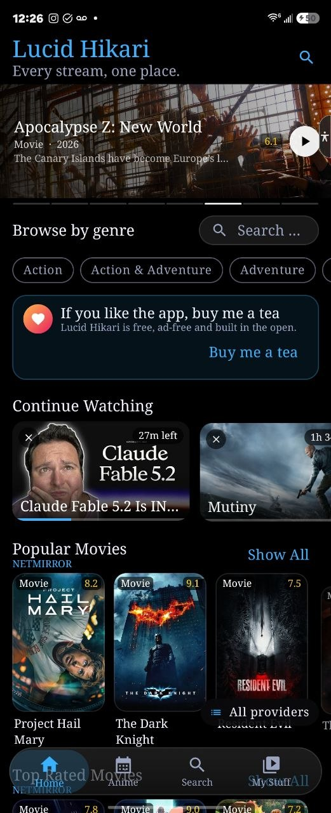 |  | 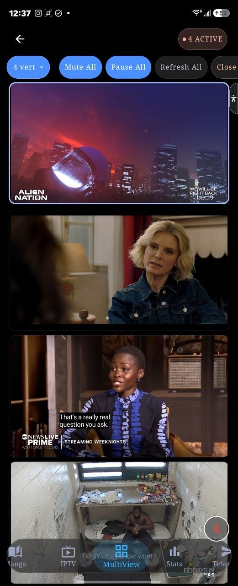 |  |

| Sports — Leagues | Sports Scores | Web Apps Grid | Web Apps Mini-Player |
|:---:|:---:|:---:|:---:|
| 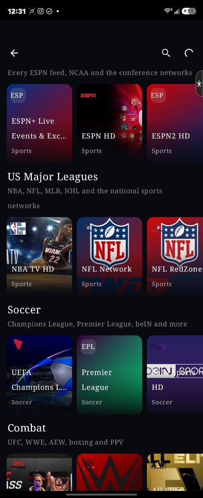 | 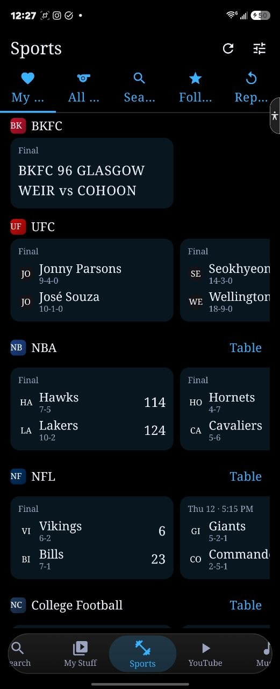 | 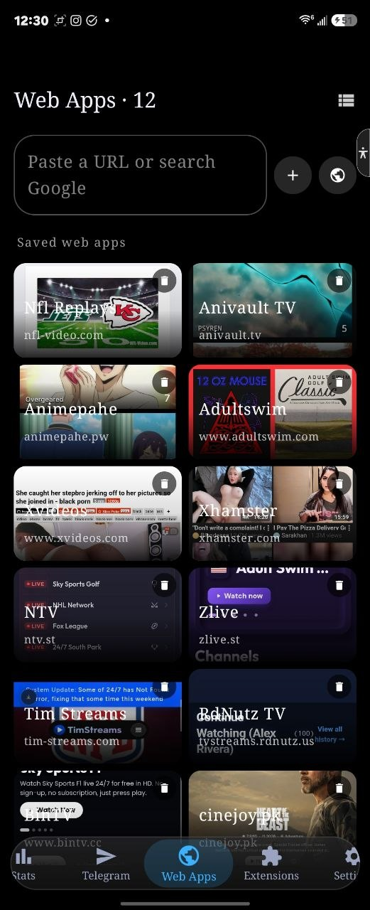 | 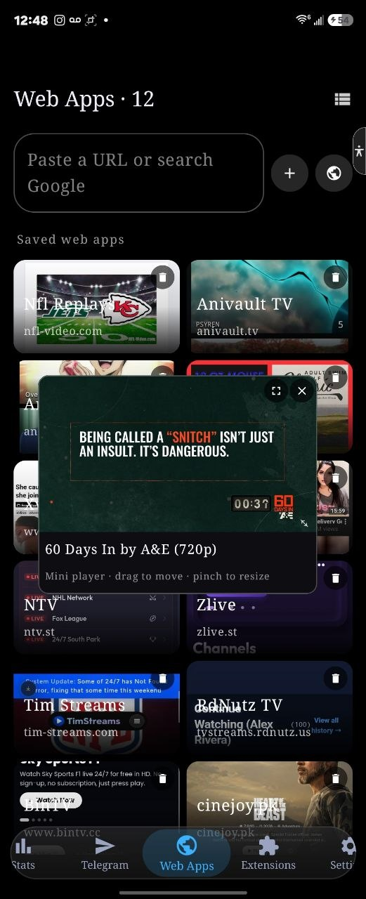 |

| Settings | Extensions & Repos | Stats Dashboard | IPTV Playlists |
|:---:|:---:|:---:|:---:|
| 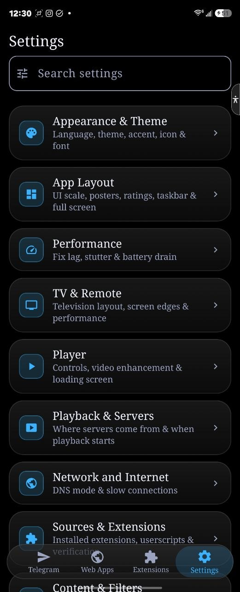 | 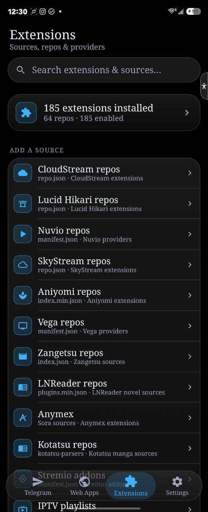 | 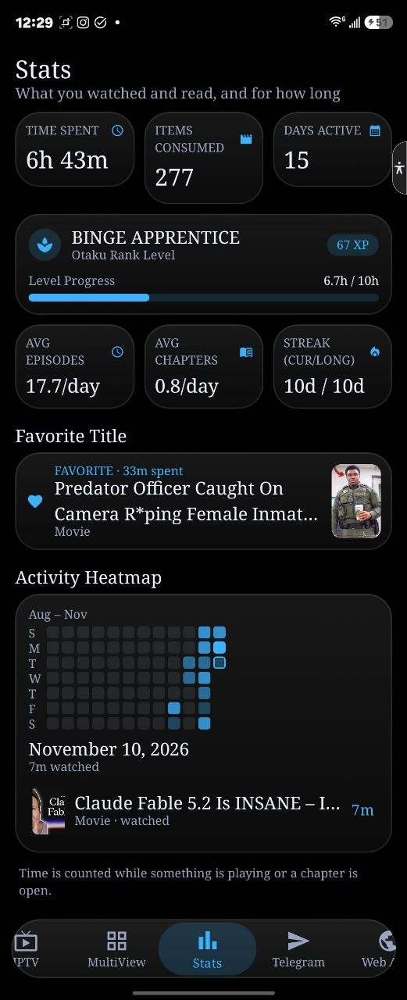 | 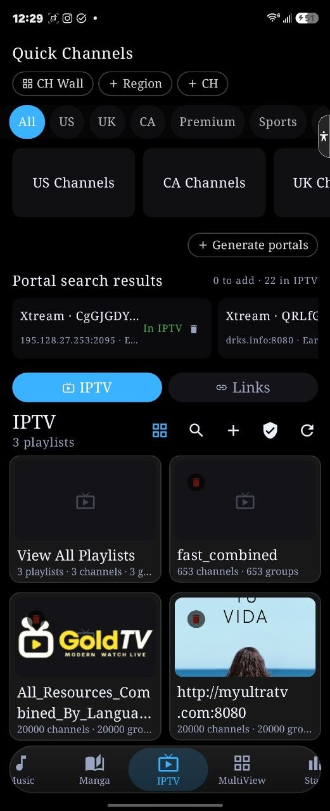 |

| Music (Deezer) | Manga | Anime Calendar |
|:---:|:---:|:---:|
| 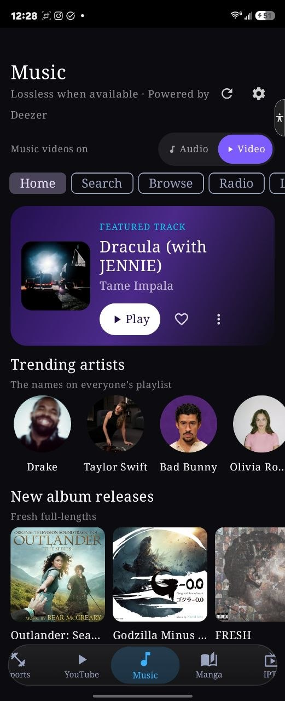 | 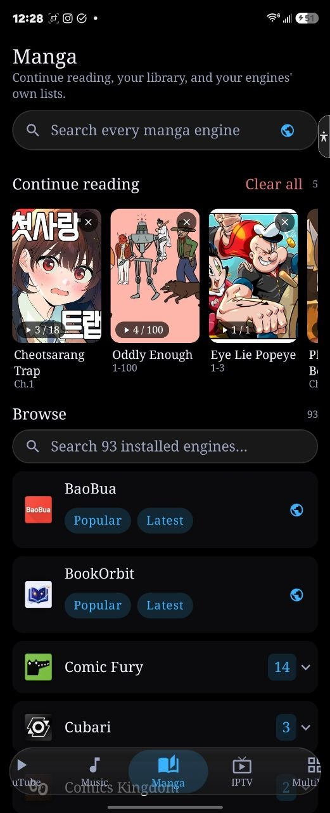 | 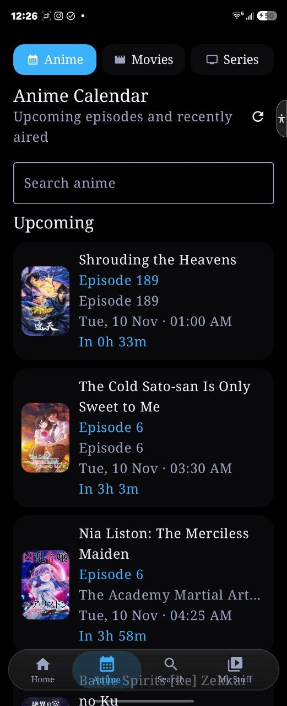 |

---

## Install

Download the latest signed APK from the **releases page**:

**<https://github.com/lucidconviction/Lucid_hikari/releases/latest>**

Open the downloaded file on your phone and allow installing unknown apps when prompted.

The release page carries a universal APK and separate 64-bit and 32-bit builds. The in-app updater picks the right one for your device.

## First setup

1. **Add your sources** — open **Extensions** to add a repository, a CloudStream plugin, a Stremio add-on or a scraper.
2. **Add live TV** — open **Live TV** and use **+** for an M3U link, a file or an Xtream portal.
3. **Make it yours** — Settings → Appearance & Theme for the theme and accent; Settings → Taskbar buttons to choose your tabs.
4. **Take the tour** — every page explains itself the first time you open it. Replay any tour in Settings → About & Updates.

## Support the project

Lucid Hikari is free and has no ads. If it is useful to you, you can buy me a tea:

**<https://www.paypal.me/Robbdeeze>**

There is also a donation banner on the Home page, directly above Continue Watching.

## Credits and thanks

Lucid Hikari would not exist without developers who shared their work, their formats and their ideas. Thank you to:

- **Hikari Devs** and the Hikari project — @codegeasse1, @error-898-15, @noreply and the Hikari contributors — the app this fork is built from.
- **Nuvio** — multi-window, scraper and player patterns.
- **SkyStream** and **Anymex** — interface, navigation and focus-driven design inspiration.
- **CloudStream** — extension format and plugin runtime.
- **Stremio** — add-on protocol and catalog model.
- **SmartTube / MediaServiceCore** — the YouTube engine.
- **Aniyomi** — manga and reader patterns.
- **TMDB, AniList, Simkl and MDBList** — metadata, artwork and tracking.
- Everyone in the Hikari, CloudStream, Stremio and Nuvio communities whose reports, fixes and extensions keep these projects alive.

## Community

- Telegram: <https://t.me/CodegeasseHikari>
- Discord: <https://discord.gg/hdwB78Ahq>
- Reddit: <https://www.reddit.com/r/HikariApp>

## License

Lucid Hikari follows the licence of the upstream Hikari project. See [LICENSE](LICENSE) for the full text.
